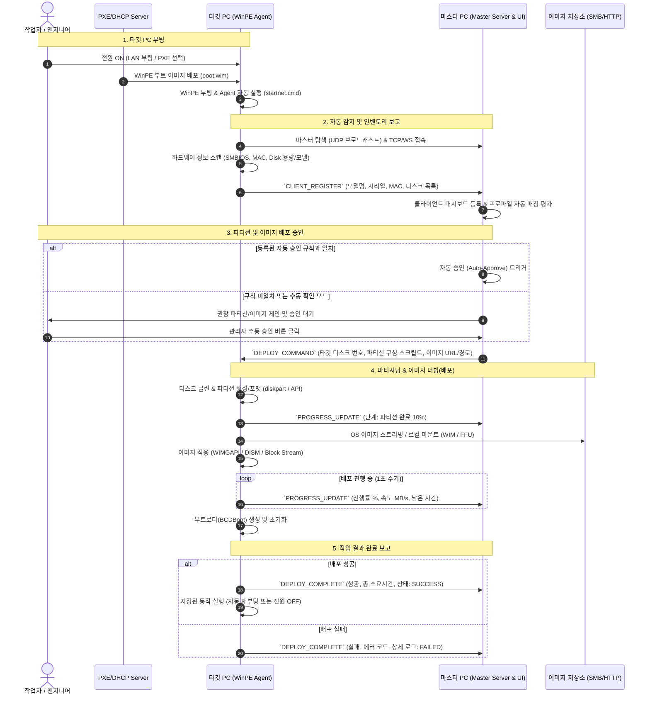

# Multi-PC Image Deployment System - 아키텍처 및 상세 설계

## 1. 시스템 흐름도 (End-to-End Workflow)

---

## 2. 하드웨어 스펙 수집 기술 (WinPE Native C++)
WinPE는 최소화된 윈도우 환경이므로 외부 종속성(런타임) 없이 순수 Win32 API 및 하드웨어 인터페이스를 호출합니다.

1. **모델명 및 시리얼 번호 (SMBIOS)**:
   - `GetSystemFirmwareTable('RSMB', 0, ...)` API 호출
   - Type 1 (System Information) 테이블 파싱:
     - Manufacturer (제조사: Lenovo, Dell, HP, Samsung, LG 등)
     - Product Name (모델명: ThinkPad T14 Gen 3, Latitude 5420 등)
     - Serial Number (시리얼 번호)
     - UUID (머신 고유 식별자)

2. **네트워크 MAC 주소 및 IP**:
   - `GetAdaptersAddresses()` (IP Helper API)
   - 물리적 유선 이더넷 어댑터 필터링, MAC Address 추출 (예: `00:1A:2B:3C:4D:5E`)

3. **디스크 및 파티션 정보**:
   - `CreateFileW(L"\\\\.\\PhysicalDrive0", ...)`
   - `IOCTL_STORAGE_QUERY_PROPERTY`: 디스크 버스 타입 (NVMe, SATA, USB), 미디어 타입 (SSD, HDD), 드라이브 모델명
   - `IOCTL_DISK_GET_DRIVE_LAYOUT_EX`: 총 용량, 파티션 테이블 형식 (GPT, MBR), 현재 파티션 개수 및 오프셋/사이즈

---

## 3. 파티션 프로파일 매칭 엔진 (Policy Engine)
마스터 프로그램에서 관리자가 "맞춤 권장 양식"을 사전 등록하고, 클라이언트 보고 시 일치하는 양식을 자동 매칭합니다.

### 규칙 조건 (Conditions):
- **모델명 정규식 / 와일드카드**: 예) `ThinkPad*`, `Latitude*`, `*` (모든 모델)
- **디스크 개수**: 1개, 2개 이상 등
- **타깃 디스크 조건**:
  - 디스크 인덱스 (Disk 0, NVMe 최우선 등)
  - 용량 범위 (예: 240GB ~ 260GB -> 256GB급, 480GB ~ 520GB -> 512GB급, 950GB 이상 -> 1TB급)

### 파티션 템플릿 (Layout Actions):
- **UEFI / GPT 표준 양식**:
  - Partition 1: EFI System (FAT32, 260MB ~ 500MB)
  - Partition 2: MSR (Microsoft Reserved, 16MB)
  - Partition 3: Windows OS (NTFS, 가변 또는 잔여 용량 전체)
  - Partition 4 (옵션): Data (NTFS, 지정 용량)
  - Partition 5 (옵션): Recovery (NTFS/WinRE, 1GB ~ 2GB)
- **Legacy / MBR 양식**:
  - Partition 1: System Reserved (NTFS, 500MB, Active)
  - Partition 2: Windows OS (NTFS, 잔여 전체)

---

## 4. 이미지 더빙(배포) 엔진 구조
- **WIM / ESD 배포 (권장 기본)**:
  - `wimgapi.dll` (Windows 내장 공식 라이브러리) C++ 연동 또는 `dism.exe /Apply-Image`
  - 장점: 파티션 크기 유연성(타깃 SSD 크기가 원본보다 작거나 커도 유연하게 적용 가능), 하드웨어 드라이버 주입 용이, 높은 압축률
- **FFU / Raw Sector 배포 (초고속 옵션)**:
  - DISM FFU 또는 섹터 블록 스트리밍
  - 장점: 파일 단위가 아닌 블록 단위 기록으로 디스크 최대 쓰기 속도 달성
